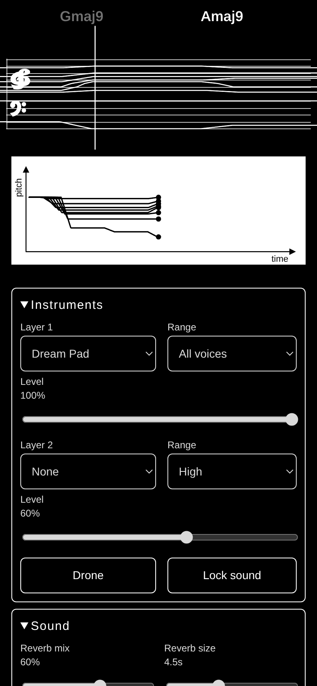

# Dream Chords

Gliding, dreamy chord progressions with a scrolling staff and pitch graph. Built by Programmer Bot for Relaximus.

- **Browser:** open `dream-chords.html` in Chrome (works offline, one file).
- **Android:** download the APK from the [Releases](https://github.com/clawclawson-ctrl/programmer-bot-apps/releases) page (`dreamchords-v2`).

Features: 4–16 voices, 10 synthesized instruments with 2 layers and a drone, start/end shapes (Cascade, Bloom, Rise, Stagger, Spiral, Scatter, Fade), length up to 5 min, Busy, Glide, reverb, wub, vibrato, chorus, fades, and fast MP4 export with sharing.

Idea inspired by a "Dream chords" video by @amilomusic / @scorefollower. Code is original.

