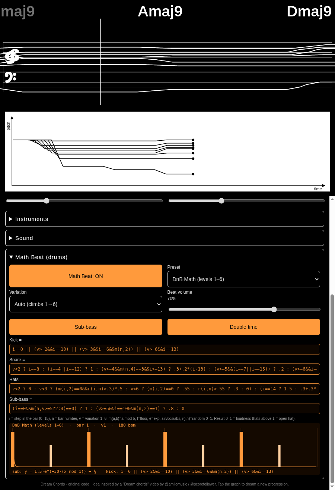
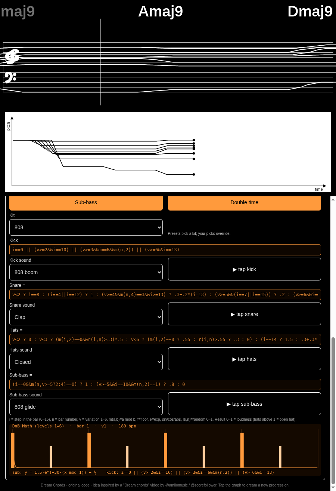
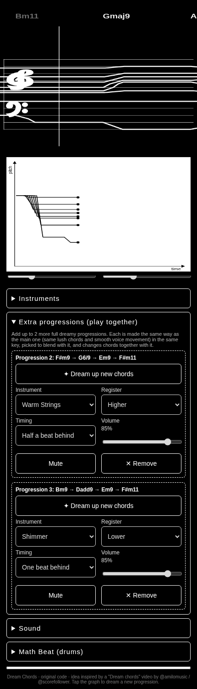
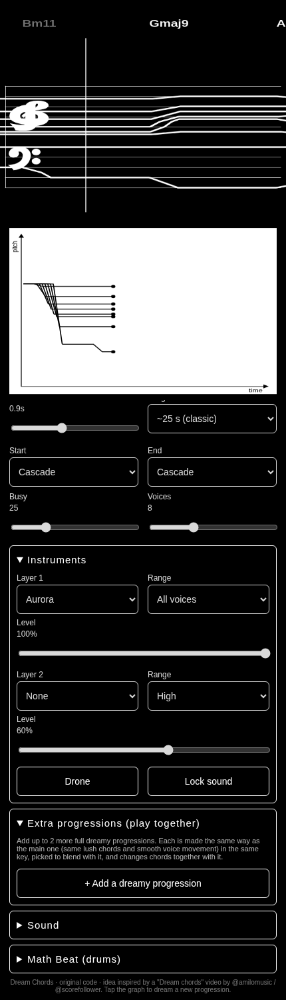
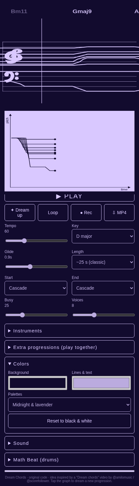

# Dream Chords

Gliding, dreamy chord progressions with a scrolling staff and pitch graph. Built by Programmer Bot for Relaximus.

- **Browser:** open `dream-chords.html` in Chrome (works offline, one file).
- **Android:** download the APK from the [Releases](https://github.com/clawclawson-ctrl/programmer-bot-apps/releases) page (latest: `dreamchords-v5`).

Features: 4–16 voices, 22 synthesized instruments with 2 layers and a drone, start/end shapes (Cascade, Bloom, Rise, Stagger, Spiral, Scatter, Fade), length up to 5 min, Busy, Glide, reverb, wub, vibrato, chorus, fades, and fast MP4 export with sharing.

Idea inspired by a "Dream chords" video by @amilomusic / @scorefollower. Code is original.

## Math Beat (v3)

An optional drum & bass layer, off until you switch it on, inspired by "drum & bass math equations".
- **Editable equations:** kick, snare, hi-hats and sub-bass each come from their own formula box. Change the math and the beat changes.
- **15 presets:** the six-level DnB Math set (plus Auto, which climbs a level every 4 bars), liquid, jungle, half-time, lo-fi, trip-hop, ambient, garage, polyrhythm, glitch and more.
- **Live graph:** an orange plot draws the equations, and a playhead sweeps across it as the beat plays.
- Follows the tempo, has its own volume, and is included in Rec and MP4 exports (the Android app too).

## Percussion sounds (v4)

Pick the sound for each Math Beat lane, or pick a whole kit at once. Everything is synthesized live, no samples.
- **Kit menu (10):** DnB, 808, 909, Lo-fi, Acoustic-ish, Latin percussion, Glitch, Ambient / soft, Heavy / dubstep, Jungle / Reese. Each preset has its own default kit, and your choice overrides it until you go back to "Preset default".
- **Kick (9):** Punchy, 808 boom, 909, Soft felt, Lo-fi thump, Distorted, Tom-kick, Sine drop, Click kick.
- **Snare / clap (10):** Snappy, Rim, Clap, 808 snare, Brush, Lo-fi crunch, Rimshot + verb, Snap, Woodblock, Gated.
- **Hats / top (10):** Closed, Open, Shaker, Tambourine, Ride, Cowbell, Cabasa, Glitch tick, Metallic ping, Conga / bongo.
- **Sub-bass (8):** Sine sub, Reese, 808 glide, Wobble, Square sub, FM bass, Pluck bass, Kick-sub (all follow the key).
- A **▶ tap** button next to each lane previews its sound. All of it is included in Rec and MP4 exports.

## Extra dreamy progressions (v5)
Add up to 2 more full progressions that play together with the main one. Each is made by the same dreamy chord generator, with lush chords and smooth voice movement, in the same key, chosen to blend with the main chords and change with them. Each one has its own instrument, "Dream up new chords" button, register (lower/same/higher), timing (together or ½–2 beats behind), volume, mute and remove.

## 12 new instruments (v5)
Glass Celesta, Tape Rhodes, Singing Bowl, Ooh Vowel Pad, Stardust Cloud, Underwater Dream, Felt Piano, Slow Bloom, Dream Harp, Cave Kalimba, Wobbly Tape Strings and Aurora. Organ now has a spinning-speaker wobble, Choir has vibrato and a soft swell, and Brass is brighter. Listen: [new-instruments-demo.mp3](new-instruments-demo.mp3) (12 s each).

## Colors (v5)
Pick the background and line/text colors, or choose a palette (Midnight & lavender, Ocean & foam, Dusk & peach, and more). The choice is remembered, text stays readable, and video exports use your colors.

Android v5 (1.4): https://github.com/clawclawson-ctrl/programmer-bot-apps/releases/download/dreamchords-v5/dreamchords-v5.apk
Older: v4 (1.3): https://github.com/clawclawson-ctrl/programmer-bot-apps/releases/download/dreamchords-v4/dreamchords-v4.apk
